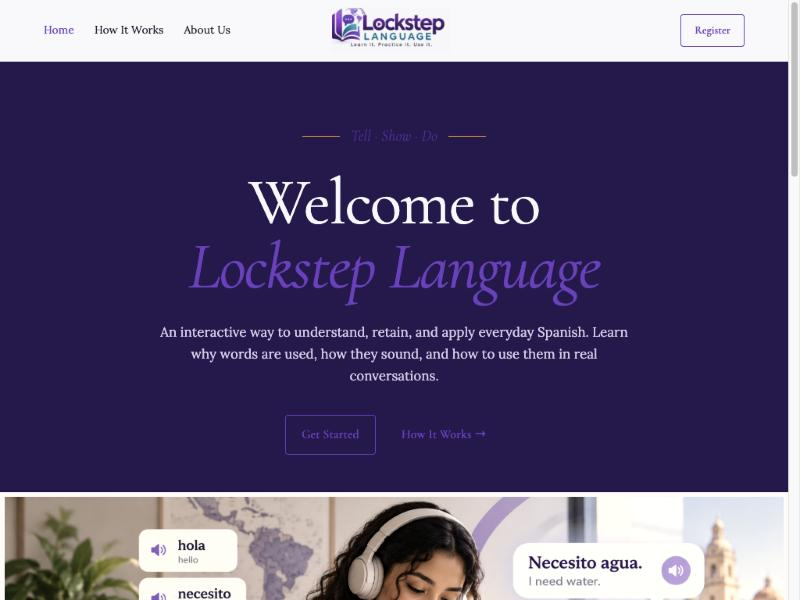
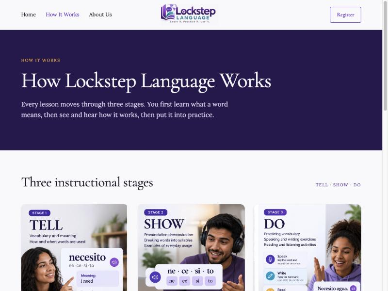
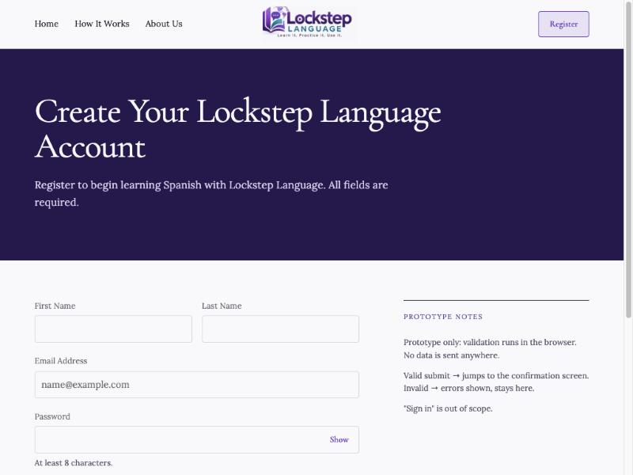
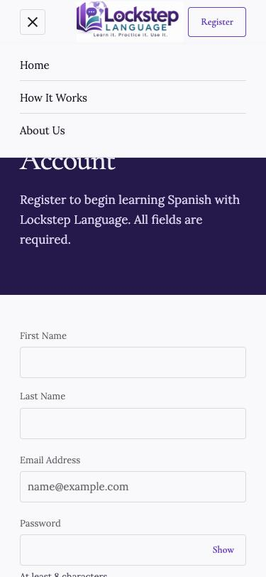

# Lockstep Language

**Learn it. Practice it. Use it.**

Lockstep Language is a front-end prototype for an interactive Spanish-learning website. It demonstrates a structured **Tell → Show → Do** teaching method across Reading, Listening, Speaking, and Writing, and walks a visitor from the homepage through a simulated account registration flow.

This repository contains the static front-end build of the site (HTML, CSS, and vanilla JavaScript) created for the FSDI 115 — Software Development Methodologies Fundamentals course.

## Table of Contents

- [Project Description](#project-description)
- [Target Audience](#target-audience)
- [Instructional Approach: Tell → Show → Do](#instructional-approach-tell--show--do)
- [Features](#features)
- [Technologies Used](#technologies-used)
- [Project Folder Structure](#project-folder-structure)
- [Installation and Setup](#installation-and-setup)
- [Running the Website Locally](#running-the-website-locally)
- [Sprint Goal](#sprint-goal)
- [Sprint User Stories](#sprint-user-stories)
- [Testing Instructions](#testing-instructions)
- [Screenshots](#screenshots)
- [Known Limitations](#known-limitations)
- [Future Development Plans](#future-development-plans)
- [Developer](#developer)
- [Repository](#repository)

## Project Description

Lockstep Language presents a Spanish-learning product concept built around a simple, repeatable lesson structure: tell the learner what a word means, show them how it sounds and is used, then have them practice it. The site introduces this method, previews sample vocabulary and lessons, explains the four language competencies it targets, and lets a visitor register for an account to "begin" their learning journey.

The purpose of this build is to demonstrate front-end development and UX/instructional-design skills: page navigation, responsive layout, interactive UI (an audio/syllable pronunciation demo), and client-side form validation — all without a backend.

## Target Audience

Adult and young-adult learners who want practical, everyday conversational Spanish rather than rote vocabulary memorization — people who want to understand *why* a word is used, not just what it means, and apply it in real situations (ordering, asking for help, small talk, etc.).

## Instructional Approach: Tell → Show → Do

Every lesson in the Lockstep method moves through three stages, illustrated on the **Home**, **How It Works**, and **Learning Method Details** pages:

1. **Tell** — What a word means, how it's used, and why it matters.
2. **Show** — Pronunciation, syllable breakdown, and sentence structure.
3. **Do** — Practice through speaking, listening, reading, and writing.

## Features

Verified directly from the source code (`index.html`, `scripts/script.js`, `styles/style.css`):

- **Single-page navigation** — Home, How It Works, Learning Method Details, About Us, Register, and a Confirmation screen all live in one `index.html` and are swapped client-side (no page reloads), via `goToPage()` in `script.js`.
- **Persistent last-viewed page** — the current page is saved to `localStorage` and restored on reload.
- **Responsive hamburger menu** — below the tablet breakpoint, navigation collapses into a toggleable menu that closes on outside click, `Escape`, or window resize.
- **Tell → Show → Do explainer sections** with the four competencies (Reading, Listening, Speaking, Writing) described on multiple pages.
- **Sample vocabulary preview** (hola, necesito, agua, gracias) on the Home page.
- **Interactive pronunciation/syllable demo** (Learning Method Details page) — clicking a word's play button plays an MP3 (`audio/necesito.mp3`, `audio/convertirse.mp3`) and highlights each syllable in sync with playback; if the audio fails to load, it falls back to a timed syllable-highlight animation.
- **Cumulative vocabulary example** — a 3-lesson sample table showing new vs. review words to illustrate spaced repetition.
- **Lesson-length example UI** — a static visual example of selectable lesson durations (4–20 minutes); this is illustrative markup only, not a wired-up control.
- **Registration form** with real-time and on-submit client-side validation (required fields, email format, 8+ character password, password confirmation match, required terms checkbox), inline error messages, a form-level error summary, and a show/hide password toggle.
- **Simulated registration flow** — a valid submission transitions to a confirmation page after a short delay; **no data is sent to a server** (see [Known Limitations](#known-limitations)).

## Technologies Used

- **HTML5** — semantic, single-file multi-"page" structure
- **CSS3** — custom properties (`:root` variables), Flexbox layout, two responsive breakpoints (`860px`, `560px`); no framework or preprocessor
- **Vanilla JavaScript (ES5-style, no build step)** — page routing, form validation, audio-synced syllable highlighting, mobile nav behavior
- **Google Fonts** — Cormorant Garamond and Lora, loaded via CDN `<link>` tags
- No package manager, bundler, or backend — this is a dependency-free static site

## Project Folder Structure

```
Lockstep Language/
├── index.html              # All pages/sections of the site
├── scripts/
│   └── script.js           # Navigation, form validation, audio/syllable demo
├── styles/
│   └── style.css           # All styling, responsive breakpoints
├── images/                 # Site imagery (hero, stage illustrations, icons, etc.)
├── audio/                  # Sample pronunciation clips (necesito, convertirse)
├── docs/
│   └── screenshots/        # Screenshots used in this README
├── .gitignore
└── README.md
```

## Installation and Setup

No installation, package manager, or build step is required — this is a static HTML/CSS/JS site with no dependencies.

```bash
git clone https://github.com/jeylofton/Lockstep-Language.git
cd Lockstep-Language
```

## Running the Website Locally

**Option 1 — Open directly:**
Double-click `index.html`, or open it in a browser via `File > Open`.

**Option 2 — Run a local static server (recommended, avoids any browser file-access restrictions on audio/images):**

```bash
python3 -m http.server 8080
```

Then visit `http://localhost:8080` in your browser.

## Sprint Goal

Deliver a responsive, navigable front-end prototype of the Lockstep Language marketing and onboarding experience — demonstrating the Tell → Show → Do teaching method, a working (simulated) registration flow, and a layout that adapts cleanly across desktop, tablet, and mobile screen sizes.

## Sprint User Stories

### US-01: Understand how it works
> As a visitor, I want to understand how Lockstep Language works so I can decide whether to register.

**Acceptance Criteria:**
- The Home page introduces the Tell → Show → Do method and the four competencies.
- A dedicated "How It Works" page walks through the three instructional stages with a worked example (*necesito*).
- A "Learning Method Details" page goes deeper: the full Tell → Show → Do sequence, how each competency is practiced, a live pronunciation/syllable demo, a cumulative-vocabulary example, and example lesson-length options.
- All of this is reachable without registering.

**Status:** ✅ Implemented and verified in `index.html` (`data-page="home"`, `"how"`, `"method"`) and exercised in the browser — navigation, content, and the pronunciation demo all function as described.

### US-02: Register for an account
> As a visitor, I want to complete a registration form so I can begin my learning journey.

**Acceptance Criteria:**
- A registration form collects first name, last name, email, password, confirm password, and Terms agreement.
- Invalid input (missing fields, bad email format, short password, mismatched passwords, unchecked terms) is caught and shown inline, with a summary error count after a submit attempt.
- A valid submission advances to a confirmation screen.

**Status:** ✅ Implemented and verified — **with an important distinction.** This is a **simulated, front-end-only registration flow.** `validateForm()` and the submit handler in `scripts/script.js` run entirely in the browser: there is no API call, server, or database. The Register page's own "Prototype notes" state this directly: *"Prototype only: validation runs in the browser. No data is sent anywhere."* **No real user account is created**, nothing is persisted beyond the current session, and "Sign in" is explicitly out of scope (a no-op link). The confirmation page's mention of a confirmation email is part of the simulated UX copy, not an actual email being sent.

### US-03: Responsive display
> As a user, I want the website to display properly on different screen sizes so I can use it on my preferred device.

**Acceptance Criteria:**
- Layout reflows cleanly at common breakpoints (tablet and mobile).
- Primary navigation becomes a hamburger menu on smaller screens and behaves correctly (opens, closes on outside click/`Escape`/resize).

**Status:** ✅ Implemented and verified — confirmed via `@media (max-width: 860px)` and `@media (max-width: 560px)` rules in `styles/style.css`, and tested in-browser at desktop and mobile (375×812) viewport sizes; the hamburger menu opens and closes correctly.

## Testing Instructions

This project has no automated test suite — it was verified through manual functional testing. To test it yourself:

1. Start the site locally (see [Running the Website Locally](#running-the-website-locally)).
2. **Navigation:** Click Home, How It Works, and About Us in the header; confirm the page content changes and the active nav link is highlighted.
3. **Pronunciation demo:** Go to How It Works → "Explore the Learning Method in Detail," then click the play button next to *necesito* or *convertirse* and confirm the audio plays while syllables highlight in sequence.
4. **Registration validation:** Go to Register and click "Create Account" with empty fields — confirm inline errors and the error-count banner appear. Fill in valid values (email format, 8+ character matching passwords, Terms checked) and submit — confirm it advances to the confirmation page.
5. **Responsiveness:** Resize the browser window (or use your browser's device toolbar) below ~860px and ~560px — confirm the layout adapts and the hamburger menu appears and functions below the tablet breakpoint.

## Screenshots

| Home | How It Works |
|---|---|
|  |  |

| Register | Mobile Navigation |
|---|---|
|  |  |

## Known Limitations

- **No real backend or authentication.** Registration is simulated entirely client-side; no accounts, sessions, or data are actually created or stored anywhere.
- **No persistent progress tracking.** Only the last-viewed page is remembered (via `localStorage`); there is no real per-user lesson history.
- **Limited audio library.** Playable pronunciation audio exists for only two sample words (*necesito*, *convertirse*); other vocabulary shown on the site has no audio.
- **Non-functional UI mockups.** The lesson-duration selector and the progress-by-competency dashboard are static illustrative visuals, not interactive, data-driven controls.
- **"Sign in" is out of scope** and intentionally a no-op link.
- **No automated tests.** Verification was manual/functional only.

## Future Development Plans

- Build a real backend (API + database) for account creation, authentication, and sign-in.
- Replace the simulated registration confirmation with real email verification.
- Expand the vocabulary and audio library beyond the two demo words.
- Make the lesson-duration selector functional and tie real progress data to a logged-in user's dashboard.
- Add automated unit and end-to-end tests.
- Optionally deploy the static site via GitHub Pages for a live public demo.

## Developer

**Jey Lofton**

## Repository

[https://github.com/jeylofton/Lockstep-Language](https://github.com/jeylofton/Lockstep-Language)
